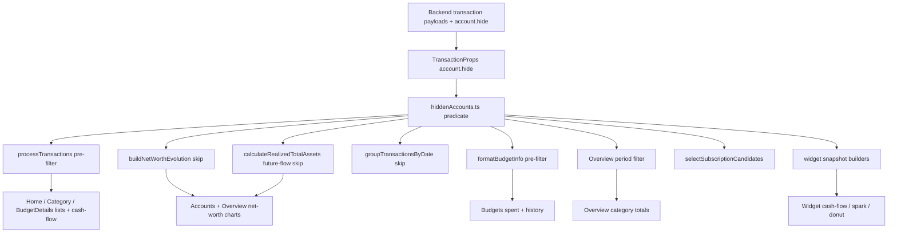

# Hidden Accounts Exclusion Design

**Spec**: `.specs/features/hidden-accounts-exclusion/spec.md`
**Status**: Draft

---

## Architecture Overview

Filter at the aggregation entry points, not at every screen. All finance math
flows through five shared utilities; every screen builds its lists through
`processTransactions` or a direct filter. One new predicate plus one-line
guards in each utility fixes all screens at once, including future callers
that route through the same utils.



Backend change is expose-only: add `account.hide` to three transaction
payloads. No server-side row filtering, so explicit single-account views keep
working.

---

## Code Reuse Analysis

### Existing Components to Leverage

| Component | Location | How to Use |
| --------- | -------- | ---------- |
| `calculateTotalAssets` hide filter | `src/utils/calculateTotalAssets.ts:33` | Precedent pattern: `.filter((account) => !account.hide)`; mirror the predicate shape, no new conversion logic |
| `InstitutionDetails` account filter | `src/screens/InstitutionDetails/index.tsx:151` | Precedent: `!account.hide && ...` combined with another condition; same conjunction style for pickers |
| `processTransactions` no-account guard | `src/utils/processTransactions.ts:98` | Hidden check sits next to `if (!item.account?.type) return;` using the same early-return style |
| `buildNetWorthEvolution` skip guards | `src/utils/buildNetWorthEvolution.ts:105` | Hidden check sits next to the `!accountCurrency` skip, same `return` style |
| `selectSubscriptionCandidates` | `src/utils/subscriptionDesignation.ts:85` | Add `&& !isHidden` conjunct; existing unit file `subscriptionDesignation.test.ts` extends the same way |
| Backend account payload | `smart-finances-backend/src/controllers/transaction.controller.ts:106` | Add `hide: transaction.account.hide` next to `name`/`type`; same additive shape as `account.controller.ts` |

### Integration Points

| System | Integration Method |
| ------ | ------------------ |
| Backend `GET /transaction`, `/by-category`, `/:id` | Additive `account.hide: boolean` field on each row; existing consumers ignore unknown fields, no migration |
| Frontend `TransactionProps.account` | `AccountProps.hide?: boolean` already declared; backend value flows through with no interface change |
| Widget snapshot composer | Pre-filter once in `buildWidgetSnapshot` before `buildCashFlow`/`buildNetWorth`, matching the existing `buildInstitutions` hide filter |

---

## Components

### `hiddenAccounts.ts` (new shared predicate)

- **Purpose**: Single definition of "transaction belongs to a hidden account".
- **Location**: `SmartFinances/src/utils/hiddenAccounts.ts`
- **Interfaces**:
  - `isHiddenAccountTransaction(t: { account?: { hide?: boolean } | null }): boolean` - true only when `t.account?.hide === true`; missing account or missing flag means visible.
  - `excludeHiddenAccountTransactions<T extends { account?: { hide?: boolean } | null }>(transactions: T[]): T[]` - non-mutating filter.
- **Dependencies**: None.
- **Reuses**: `calculateTotalAssets` filter semantics (strict `=== true`, absent means visible).

### Backend transaction payloads (expose `hide`)

- **Purpose**: Give every client filter the data it needs (HIDE-06).
- **Location**: `smart-finances-backend/src/controllers/transaction.controller.ts` (`getTransactions`, `getTransactionsByCategory`, `getTransactionById`, plus `related_transaction.account` on the detail route).
- **Interfaces**: Additive `account: { ..., hide: boolean }`; missing account returns the row without `hide` rather than failing.
- **Dependencies**: Prisma `account.hide` column (already selected via `include`).
- **Reuses**: `account.controller.ts` formatted payloads that already expose `hide`.

### Aggregation guards (frontend math)

- **Purpose**: Exclude hidden rows from every total and chart (HIDE-03, HIDE-04).
- **Location**:
  - `SmartFinances/src/utils/processTransactions.ts` - pre-filter input at the top (Home, TransactionsByCategory, BudgetDetails, single-account flows inherit).
  - `SmartFinances/src/utils/buildNetWorthEvolution.ts` - skip hidden rows in the per-period loop (Accounts + Overview charts).
  - `SmartFinances/src/utils/calculateRealizedTotalAssets.ts` - skip hidden rows in the future-flow back-out loop (balances already covered by `calculateTotalAssets`).
  - `SmartFinances/src/utils/groupTransactionsByDate.ts` - skip hidden rows in day totals and drop them from groups (defense in depth; idempotent with the `processTransactions` pre-filter).
  - `SmartFinances/src/utils/budgetCalculations.ts` (`formatBudgetInfo`) - pre-filter hidden before category/period matching.
  - `SmartFinances/src/screens/Overview/index.tsx` (`transactionsBySelectedPeriod`) - pre-filter hidden once; `calculateTotals` and `patrimonialEvolution` inherit.
  - `SmartFinances/src/widgets/buildWidgetSnapshot.ts` - pre-filter hidden in the composer before `buildCashFlow`/`buildNetWorth`.
- **Interfaces**: No signature changes; each site calls `excludeHiddenAccountTransactions` or `isHiddenAccountTransaction` inline.
- **Dependencies**: New `hiddenAccounts.ts` only.
- **Reuses**: Existing skip-guard style at each site (early `return` inside `forEach`).

### List and picker guards (frontend selection surfaces)

- **Purpose**: Exclude hidden rows/accounts from every selectable list (HIDE-01, HIDE-02).
- **Location**:
  - `SmartFinances/src/utils/subscriptionDesignation.ts` (`selectSubscriptionCandidates`) - `&& !isHiddenAccountTransaction(t)`.
  - Account pickers - add `&& !account.hide` next to the existing `!account.isVirtual`: `AccountSelect`, `AccountFilterSelect`, `AccountDestinationSelect`, `GoalAccountSelect`, `RegisterGoalMovement` selectable, `GoalDetails` delete destinations.
- **Interfaces**: No signature changes.
- **Dependencies**: New predicate for the selector; plain `!account.hide` for account arrays (matches `InstitutionDetails` precedent).
- **Reuses**: `!account.isVirtual` conjunction pattern already at each picker.

---

## Data Models (if applicable)

No schema or interface changes.

```typescript
// Already declared; backend value flows through after the payload change.
interface AccountProps {
  hide?: boolean;
}
```

**Relationships**: `TransactionProps.account: AccountProps` carries the flag; every guard reads `transaction.account?.hide` and treats absent as visible.

---

## Error Handling Strategy

| Error Scenario | Handling | User Impact |
| -------------- | -------- | ----------- |
| Transaction payload lacks `hide` (old backend / optimistic row) | Treated as visible; no throw | Row stays listed until backend deploys; no crash |
| Transaction has no account object | Keep existing per-site no-account handling unchanged | Optimistic updates behave exactly as today |
| All accounts hidden | Totals render 0, lists render empty state | Correct empty UI, no error |
| Backend `account` include returns null | Row returned without `hide` (HIDE-06 AC4) | Row visible; no 500 |

---

## Risks & Concerns

| Concern | Location (file:line) | Impact | Mitigation |
| ------- | -------------------- | ------ | ---------- |
| Double-filtering (screen + util) diverges | `Home/index.tsx:302`, `processTransactions.ts:87` | Redundant but harmless; future editors may remove one thinking it is dead | Util-level filter is the contract; screens do not add their own transaction hide filter (pickers excepted, documented in tasks) |
| Backend test mocks lack `hide` | `smart-finances-backend/src/__tests__/transaction.controller.test.ts` | New assertions on `hide` fail against stale mocks | Update `listRow`/`makeTransaction` helpers to include `hide: false` plus one `hide: true` row |
| Transfer per-leg semantics surprise | `processTransactions.ts:89` | Hidden-leg transfer disappears from one account view but visible leg remains | Spec-locked per-leg rule; no new linking logic; call out in the commit body |
| `formatTransactions` drops `account.hide` | `SmartFinances/src/utils/formatTransactions.ts:27` | Downstream guards lose the flag if the mapper reconstructs `account` | It spreads `account: item.account` by reference today; task pins a regression test that `hide` survives formatting |
| Widget snapshot tested with hand-built rows | `SmartFinances/src/widgets/buildWidgetSnapshot.ts:285` | Hand-built fixtures without `hide` default to visible, silently passing | New widget test uses explicit `hide: true` rows and asserts exclusion from cash-flow/spark/donut |

---

## Tech Decisions (only non-obvious ones)

| Decision | Choice | Rationale |
| -------- | ------ | --------- |
| Filter in shared utils, not screens | One-line guards in `processTransactions`, `buildNetWorthEvolution`, `calculateRealizedTotalAssets`, `groupTransactionsByDate`, `formatBudgetInfo` | Every list/chart routes through them; screens get the fix without edits and future callers inherit it |
| Backend exposes, never filters | Additive `account.hide` on three endpoints; `where` clauses untouched | Explicit single-account views and future clients need raw rows plus the flag |
| Strict `=== true` predicate, absent means visible | `isHiddenAccountTransaction` returns true only for `hide === true` | Matches `calculateTotalAssets` semantics; old payloads and optimistic rows degrade to visible instead of vanishing |
| No changes to AccountsList / BankingIntegrationDetails / InstitutionDetails / Accounts list | Leave as-is (first two keep showing hidden; latter two already exclude) | Spec HIDE-05: management surfaces unchanged; no churn where behavior is already correct |

---
