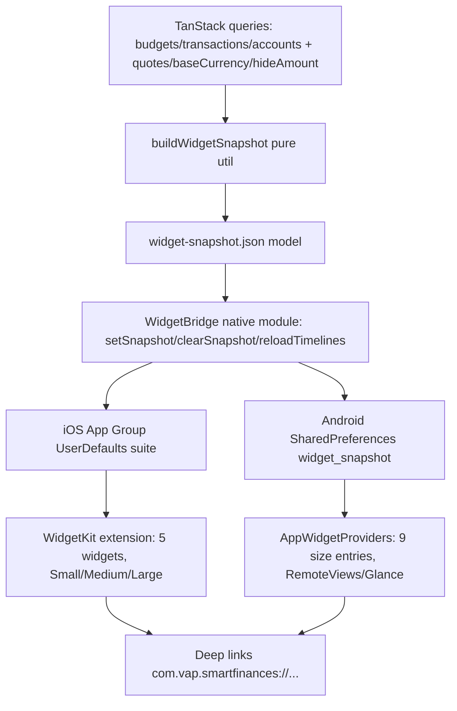

# Home Widgets Design

**Spec**: `.specs/features/home-widgets/spec.md`
**Status**: Draft

---

## Architecture Overview

One JS-built snapshot feeds dumb native widgets on both platforms. All money math stays in TypeScript; Swift/Kotlin only parse JSON and lay out views.



---

## Code Reuse Analysis

### Existing Components to Leverage

| Component | Location | How to Use |
| --------- | -------- | ---------- |
| `formatBudgetInfo` + `getBudgetPeriods` | `src/utils/budgetCalculations.ts` | Current-period spend % per budget (AD-001 calendar months); snapshot sorts desc by `percentage` |
| `useFormattedBudgets` pattern | `src/hooks/useFormattedBudgets.ts` | Snapshot builder consumes the same `useBudgetsQuery` + `useTransactionsQuery` pair, no new fetch |
| `calculateTotalAssets` / `calculateRealizedTotalAssets` | `src/utils/calculateTotalAssets.ts`, `buildNetWorthEvolution.ts` | Net-worth seed + sparkline points; reuse, do not reimplement natively |
| `processTransactions` month filter + `isDateInSelectedPeriod` | `src/utils/processTransactions.ts`, `isDateInSelectedPeriod.ts` | Cash-flow month totals (realized only, `created_at <= now`) |
| `formatCurrency` | `src/utils/formatCurrency.ts` | Pre-format every snapshot string in pt-BR; native side displays verbatim |
| `useUserConfigs` (`hideAmount`, `baseCurrency`) | `src/stores/userConfigsStorage.ts` | Snapshot `hidden` flag + `baseCurrencyCode`; widgets mask when true |
| Deep-link scheme | `android/app/src/main/AndroidManifest.xml`, `app.json` | `com.vap.smartfinances://` (+ `exp+smart-finances` dev); iOS URL handling mirrors Android intent-filter |
| EAS build profiles | `eas.json` | Native targets build through existing `development`/`preview`/`production` profiles; no new workflow |

### Integration Points

| System | Integration Method |
| ------ | ------------------ |
| iOS App Group | New group `group.com.vap.smartfinances.widgets`; main app + Widget extension share `UserDefaults(suiteName:)` slot `widgetSnapshot` |
| Android shared state | `SharedPreferences("widget_snapshot")` key `snapshot` + `AppWidgetManager.notifyAppWidgetViewDataChanged` / Glance state update |
| Auth state | Snapshot writer reads `useAuth().isSignedIn`; sign-out clears snapshot via `clearSnapshot()` → locked placeholder (WDG-37) |
| OTA (Revopush) | JS-only (snapshot builder, sync hook) ships via OTA; native layouts/extension/providers require store binary update |

---

## Components

### `buildWidgetSnapshot` (pure)

- **Purpose**: Derive the full widget payload from already-fetched query data.
- **Location**: `src/widgets/buildWidgetSnapshot.ts`
- **Interfaces**:
  - `buildWidgetSnapshot(input: SnapshotInput): WidgetSnapshot` - budgets sorted by % desc, top-3/6 slices, cash-flow month totals + bar arrays, critical budget, net worth + sparkline + donut slices, top-2 institutions, `hidden`, `signedIn`, `generatedAt`, pre-formatted strings.
- **Dependencies**: `budgetCalculations`, `calculateTotalAssets`, `buildNetWorthEvolution`, `formatCurrency`.
- **Reuses**: All utils above; zero network.

### `useWidgetSnapshotSync` (hook)

- **Purpose**: Rewrite the snapshot on every relevant change and on foreground.
- **Location**: `src/widgets/useWidgetSnapshotSync.ts`
- **Interfaces**:
  - `useWidgetSnapshotSync(): void` - subscribes to budgets/transactions/accounts queries + `hideAmount`/`baseCurrency`/auth; debounced (~1s) `WidgetBridge.setSnapshot(JSON)` then `reloadTimelines()`; `clearSnapshot()` on sign-out.
- **Dependencies**: TanStack query caches, `WidgetBridge`, AppState foreground listener.
- **Reuses**: `useFormattedBudgets` data shape; existing pull-to-refresh and mutation invalidation paths trigger it for free.

### `WidgetBridge` (Expo native module)

- **Purpose**: JS→native shared-storage pipe + timeline nudge.
- **Location**: `modules/widget-bridge/` (local Expo module: `ios/WidgetBridge.swift`, `android/.../WidgetBridgeModule.kt`, `expo-module.config.json`)
- **Interfaces**:
  - `setSnapshot(json: string): void`, `clearSnapshot(): void`, `reloadTimelines(): void`
- **Dependencies**: App Group entitlement (iOS), SharedPreferences (Android).
- **Reuses**: Nothing existing; new thin bridge (no business logic).

### iOS Widget Extension

- **Purpose**: Render all families/sizes with WidgetKit.
- **Location**: `targets/widgets/` (generated by config plugin; SwiftUI views per family, one `WidgetBundle`, `AppIntent` for Overview Small Variant A/B)
- **Interfaces**:
  - `SnapshotEntry timeline(from shared UserDefaults)` - read-only, no network.
  - Supported families: Budgets Medium (`systemMedium`), Budgets Large (`systemLarge`), CashFlow Small/Medium, Overview Small (intent-configurable A/B), Control Medium/Large, Patrimony Small/Medium.
- **Dependencies**: Shared snapshot model (mirrored `Decodable` struct), deep-link URLs.
- **Reuses**: Pre-formatted strings; native-only bar/sparkline/donut drawing (Gifted-Charts not available in extensions).

### Android Widget Providers

- **Purpose**: Render all families/sizes with Glance (RemoteViews fallback).
- **Location**: `targets/widgets-android/` (config plugin output: `WidgetProvider` per family-size, `res/xml/*_info.xml`, Glance layouts)
- **Interfaces**:
  - 9 providers: budgets-medium (4x2), budgets-large (4x4), cashflow-small (2x2), cashflow-medium (4x2, horizontal bars), overview-small (2x2, `widgetOptions` variant), control-medium (4x2), control-large (4x4), patrimony-small (2x2), patrimony-medium (4x2).
  - `targetCellWidth/Height` pinned per size; `resizeMode="horizontal|vertical"`; `description` pt-BR.
- **Dependencies**: SharedPreferences snapshot, PendingIntents per tap target.
- **Reuses**: Pre-formatted strings; native bar orientation differs per spec (Android Medium cash-flow horizontal).

### Config Plugin `withHomeWidgets`

- **Purpose**: Keep `android/` + `ios/` (committed prebuild) reproducible: inject extension target, providers, entitlements, permissions.
- **Location**: `plugins/withHomeWidgets/`
- **Interfaces**:
  - `withHomeWidgets(config, { iosGroup, androidProviders })` - idempotent prebuild step.
- **Dependencies**: `@expo/config-plugins`.
- **Reuses**: Existing `app.config.ts` plugin array pattern.

---

## Data Models (if applicable)

### `WidgetSnapshot`

```typescript
interface WidgetSnapshot {
  version: 1
  generatedAt: string // ISO
  signedIn: boolean
  hidden: boolean
  baseCurrencyCode: string
  budgets: Array<{ id: string; name: string; percent: number; percentLabel: string; statusText: string; over: boolean }>
  cashFlow: { monthLabel: string; income: string; expenses: string; bars: Array<{ income: number; expense: number }> }
  overview: { total: string; alertName: string | null; alertPercent: string | null; alertOver: boolean; criticalName: string | null; criticalPercent: string | null }
  netWorth: { total: string; spark: number[]; donut: Array<{ categoryId: string; value: number; label: string }> }
  institutions: Array<{ id: string; name: string; accountCount: number; balance: string }>
}
```

**Relationships**: `budgets` pre-sorted by % desc (Medium takes 3, Large takes 6); `institutions` pre-sorted by balance desc (take 2). Native sides slice, never sort.

---

## Error Handling Strategy

| Error Scenario | Handling | User Impact |
| -------------- | -------- | ----------- |
| Shared container write fails | Keep previous snapshot; retry on next refresh/foreground | Stale data, never blank |
| Snapshot missing/corrupt | Locked/setup placeholder per WDG-39 | Prompt to open app |
| Signed out | `clearSnapshot()` → locked placeholder (WDG-37) | No financial values leak |
| Offline / OS timeline tick | Render last snapshot, no network (WDG-36/38) | Instant, no error |
| Stale app kill (in-memory Clerk session gone, snapshot remains) | Documented limitation: widget keeps last snapshot until next unlock + app foreground rewrites/clears it | See Risks & Concerns |

---

## Risks & Concerns

| Concern | Location (file:line) | Impact | Mitigation |
| ------- | -------------------- | ------ | ---------- |
| Stale snapshot visible after app kill without re-auth (tokenCache is in-memory-only) | `src/app/_layout.tsx:40-51` | Home-screen figures persist past process death until user reopens app | Snapshot carries `generatedAt`; docs + empty-state copy note data is as-of last app open; sign-out path always clears; future: expiry-by-age in widget (e.g. grey-out after 7d) |
| Prebuild dirs committed (`android/`, `ios/`) drift from config plugin output | `android/app/src/main/AndroidManifest.xml`, `ios/SmartFinances/` | Manual native edits lost on `expo prebuild` | All native changes flow through `plugins/withHomeWidgets`; CI runs `expo prebuild --check` equivalent |
| Release minify (`minifyEnabled`, `shrinkResources`) strips widget receivers/layouts | `android/app/build.gradle:127-129` | Widgets missing in release | `proguard-rules.pro` keep rules for providers + Glance; verify on release build, not just debug |
| OTA cannot ship native widget UI | `app.config.ts` (Revopush plugin) | Layout fixes need store release | Snapshot/JS logic OTA-safe; native layout changes batched into versioned releases |
| No RN chart lib inside extensions | `package.json` (gifted-charts) | Must draw bars/sparkline/donut natively | Keep chart inputs as plain number arrays; snapshot tests pin array shapes |
| Test coverage gap: no native widget test harness in repo | `jest` setup (`package.json:33`) | Widget UI verified manually | Gate native rendering via snapshot unit tests (1:1 AC mapping) + manual QA matrix on devices; no fake native tests |

---

## Tech Decisions (only non-obvious ones)

| Decision | Choice | Rationale |
| -------- | ------ | --------- |
| Transport: shared-prefs JSON, not files | iOS App Group UserDefaults + Android SharedPreferences (~10-20KB JSON) | No file-path/permission edge cases; atomic string write; both platforms have precedent (`react-native-shared-group-preferences` pattern) |
| One extension / provider set, not per-size targets | Single iOS `WidgetBundle`, one Android provider per family-size entry | Respects exact 3/6-row and chart-orientation specs while minimizing manifest sprawl |
| Variant B as widget config, not app setting | iOS AppIntent + Android `widgetOptions` | User decision; per-instance choice, survives app data clears |
| Budgets order by % desc | Snapshot sorts, native slices | User refinement 2026-11-10; keeps native dumb |

> **Project-level decisions:** AD-006 proposed below — snapshot-bridge pattern becomes the standard for any future widget family.
