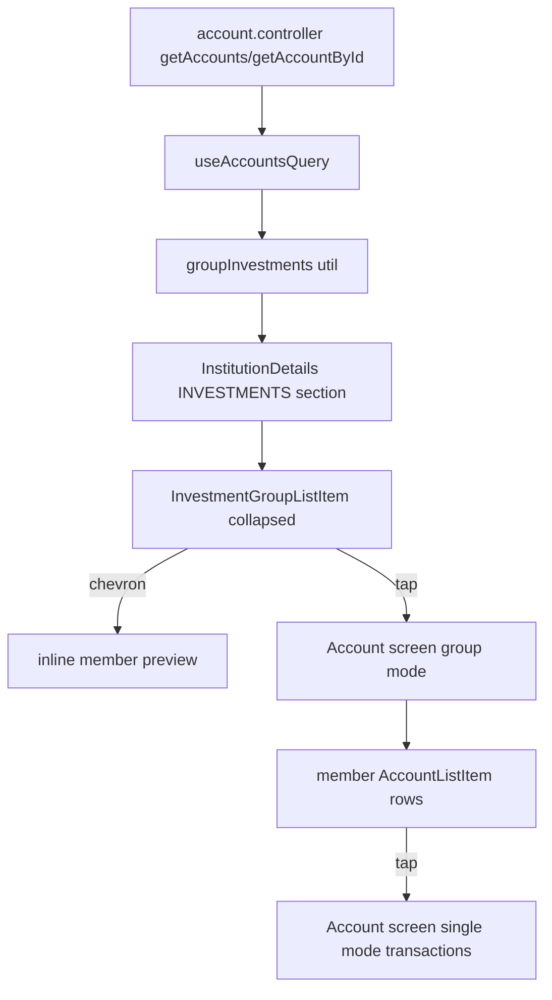

# Investment Consolidation Design

**Spec**: `.specs/features/investment-consolidation/spec.md`
**Status**: Draft

---

## Architecture Overview

Client-side presentational grouping. No DB merge, no new route. Backend only widens the existing accounts payload with already-persisted `providerMetadata`; all grouping, summing, and navigation state stay in the frontend.



Group mode reuses `/accounts/[accountId]` with a synthetic `accountId = group:<hash>` plus member id list in `currentAccountSelectedStorage`. The Account screen branches on that prefix: group mode renders the member list, single mode is untouched.

---

## Code Reuse Analysis

### Existing Components to Leverage

| Component | Location | How to Use |
| -------------------- | ------------------- | ----------------- |
| `getSectionKey`, `SECTION_ORDER`, `SECTION_TITLES` | `src/screens/InstitutionDetails/index.tsx:80-103` | Keep verbatim; grouping applies inside INVESTMENTS data only |
| `AccountListItem` | `src/components/AccountListItem/` | Reuse for member rows in preview and Account group mode |
| `filterSectionsByQuery` | `src/utils/filterSectionsByQuery.ts` | Extend with group-aware matcher, keep signature for other sections |
| `convertCurrency` + quotes stores | `src/utils/convertCurrency.ts`, `src/stores/quotesStorage.ts` | Sum group headers in base currency, same path as `processedData` |
| `useAccountsQuery` | `src/hooks/useAccountsQuery.ts` | Single fetch source; grouping is a `useMemo` downstream |
| `useCurrentAccountSelected` + `handleOpenAccount` | `src/stores/currentAccountSelectedStorage.ts`, `InstitutionDetails:312-326` | Extend store payload with optional `groupKey`/`groupMemberIds`, reuse navigate call |
| `upsertInvestmentAccount` metadata shape | `smart-finances-backend/src/services/bankingSync.service.ts:168-224` | Contract source for `InvestmentDetails` fields |

### Integration Points

| System | Integration Method |
| -------------- | --------------------------------------- |
| Backend accounts read | Add `providerMetadata` to `getAccounts`/`getAccountById` formatted output when `type == INVESTMENTS` (already stored, just unexposed) |
| Frontend types | Extend `AccountProps` with optional `investmentData?: InvestmentDetails` mapped from `providerMetadata` |
| Account screen | Branch on `accountId.startsWith('group:')`: group-member list vs. existing transaction SectionList |

---

## Components

### Backend: expose investment metadata

- **Purpose**: Make rate/maturity/profit renderable without refetch
- **Location**: `smart-finances-backend/src/controllers/account.controller.ts` (`getAccounts`, `getAccountById`)
- **Interfaces**:
  - `GET /account` item gains `investmentData?: InvestmentDetails | null` (only when `type == INVESTMENTS`)
- **Dependencies**: Prisma `providerMetadata` Json column
- **Reuses**: Existing formatted-account mapping; no schema migration

### Frontend type: InvestmentDetails + group

- **Purpose**: Typed contract for card and grouping
- **Location**: `src/interfaces/accounts.ts` (extend), new `src/utils/groupInvestments.ts`
- **Interfaces**:
  - `buildInvestmentGroupKey(a: AccountProps): string` - `type|subtype|rateType|rate` normalized, `manual` bucket when no metadata
  - `groupInvestments(accounts: AccountProps[]): InvestmentGroup[]`
  - `sumGroupBalance(members, quotes, baseCode): number`
  - `grossProfitOf(d): number | null` - `currentGrossAmount - amountOriginal`
  - `netProfitOf(d): number | null` - `amountProfit ?? (currentNetAmount - amountOriginal)`
- **Dependencies**: `decimal.js` for sums, `convertCurrency` for FX
- **Reuses**: Same conversion path as InstitutionDetails `processedData`

### UI: InvestmentGroupListItem (collapsible)

- **Purpose**: Collapsed header (sum + count + rate/profit teaser) with inline expand
- **Location**: `src/components/InvestmentGroupListItem/`
- **Interfaces**:
  - `data: InvestmentGroup; expanded: boolean; onToggle(): void; onOpen(): void; hideAmount?: boolean`
  - Renders chosen card layout (see Layouts) + `CaretDown/CaretRight` affordance
- **Dependencies**: `AccountListItem` for preview rows (max 3 + "+N")
- **Reuses**: `FadeInUp` entrance, `BankIcon`, theme tokens

### UI: Account screen group mode

- **Purpose**: Full member list for one group, reusing the familiar Account chrome
- **Location**: `src/screens/Account/index.tsx` (branch), store extension in `currentAccountSelectedStorage.ts`
- **Interfaces**:
  - Store gains `accountGroupKey?: string | null; accountGroupMemberIds?: string[] | null`
  - Group mode header shows group label + summed balance; body is a FlatList of member `AccountListItem`s navigating to single mode
- **Dependencies**: `useAccountsQuery` cache (no new fetch; filter by member ids)
- **Reuses**: Existing `Screen`, `Header`, `SearchBar` patterns

---

## Data Models (if applicable)

### InvestmentDetails

```typescript
interface InvestmentDetails {
  investmentType: string | null;
  investmentSubtype: string | null;
  investmentStatus: string | null;
  rate: string | null;          // "100", "12.5"
  rateType: string | null;      // "CDI", "IPCA"
  issuer: string | null;
  currentGrossAmount: string | null;
  amountOriginal: string | null;
  amountProfit: string | null;
  currentDate: string | null;
  issuedAt: string | null;
  expiresAt: string | null;     // maturity
}
```

**Relationships**: 1:1 with `AccountProps.investmentData`; sourced from `Account.providerMetadata` JSON.

### InvestmentGroup

```typescript
interface InvestmentGroup {
  key: string;                  // type|subtype|rateType|rate
  label: string;                // "CDB · 100% CDI"
  investmentType: string | null;
  investmentSubtype: string | null;
  rate: string | null;
  rateType: string | null;
  members: AccountProps[];      // 1..N, singles stay ungrouped when key is `manual`
  totalBalanceBase: number;     // converted sum
  count: number;
}
```

---

## Card Layout Proposals (3 options)

All three show `rateType + rate` and maturity, and add the profit the user asked for (gross = `currentGrossAmount - amountOriginal`; net = `amountProfit ?? currentNet - original`). Collapsed group headers use the same layout with summed balance + `(N)` count.

### Layout 1 — Chip strip (compact, closest to today)

```
[CDB · 100% CDI]                    R$ 1.550,12 (3)
[+R$ 50,04 bruto]  [Venc 12/2028]
```

- Line 1: product label + summed balance + count. Line 2: profit chip + maturity chip.
- Pros: smallest height, drops into existing `AccountListItem` shape, best for 38-row collapse.
- Cons: profit is secondary, harder to compare gains at a glance.

### Layout 2 — Financial highlight (recommended)

```
CDB · 100% CDI                    R$ 1.550,12
Nu Financeira · Venc 12/2028        +R$ 50,04 ▲
```

- Left: product + issuer/maturity muted. Right: balance large + profit delta green (or red when negative).
- Pros: matches Q2 exactly (rate + profit prominent); scannable gains; group and member rows share the pattern.
- Cons: ~8pt taller than today; needs profit-fallback rule (balance only when no basis).

### Layout 3 — Detail table (densest)

```
CDB - NU FINANCEIRA ...             R$ 700,06
TAXA: 100% CDI | REND: +R$ 50,04 | VENC: 12/2028
```

- Three labeled mini-columns under the name.
- Pros: most comparable across groups (taxa/rendimento/vencimento always in the same slot).
- Cons: crowded at 320pt widths, truncates issuer names, noisier with 38 rows.

**Recommendation**: Layout 2 for member rows and group headers (profit visibility is the stated goal), with Layout 1 chip styling for the maturity/profit line. Awaiting user pick before Tasks.

---

## Error Handling Strategy

| Error Scenario | Handling | User Impact |
| -------------- | -------- | ---------- |
| `providerMetadata` null (manual) | Route to ungrouped single at end of INVESTMENTS | Renders legacy name + balance, no chips |
| `rate`/`rateType`/`expiresAt` null | Omit that chip/column | No "null" text, no crash |
| `expiresAt` unparseable | Omit maturity chip, log warn | Row still renders |
| Mixed currencies in one group | Convert each leg via `convertCurrency` before sum; show per-leg currency in preview | Header total in base currency, correct to the cent |
| Group with 1 member | Render as single (no collapse affordance) | No pointless expand control |
| Search matches member | Return whole group, auto-expand to match | "Entire matching group" per Q4 |

---

## Risks & Concerns

| Concern | Location (file:line) | Impact | Mitigation |
| ------- | -------------------- | ------ | ---------- |
| Account screen is single-account oriented (transactions SectionList, cash flow, edit sheet) | `SmartFinances/src/screens/Account/index.tsx:98-230` | Group mode could tangle single-mode logic | Strict branch at top of render: group mode returns member-list layout before any single-account hooks consume the synthetic id |
| Store has no group concept; synthetic `group:` id could leak into edit/delete flows | `src/stores/currentAccountSelectedStorage.ts:10-33` | Edit/delete on a group id would 404 | Group mode hides edit/delete/register-transaction FAB; member rows navigate to real ids for those actions |
| Group sums diverge from institution total | `InstitutionDetails:210-215` | User distrusts totals | Single `sumGroupBalance` helper used by both header and institution total; Tasks adds reconciliation test |
| Backend exposes raw Json without shape guard | `account.controller.ts:50-99` | Malformed metadata crashes card | Whitelist-map only the 12 `InvestmentDetails` fields; drop the rest |
| 38-row FlatList + expand state re-renders | `InstitutionDetails:397-451` | Jank on expand | `useMemo` groups, `keyExtractor` on group key, preview capped at 3 rows |

---

## Tech Decisions (only non-obvious ones)

| Decision | Choice | Rationale |
| ----------------- | --------------- | --------- |
| Grouping location | Client-side `useMemo` in InstitutionDetails | No migration, no sync change; key already in payload once exposed |
| Group navigation | Synthetic `group:<hash>` id on existing Account route | Satisfies "continuar abrindo a tela Account"; zero new-route boilerplate |
| Profit basis | Gross default, net when `amountProfit` present | Openi persists all three (`currentGrossAmount`, `currentNetAmount`/`balance`, `amountOriginal`, `amountProfit`); net preferred per Q2 |
| Search semantics | Whole-group match | Explicit Q4 decision |

> **Project-level decisions:** none new. If the `group:<hash>` synthetic-id pattern proves reusable for future wallet/crypto rollups, promote it to an AD entry then.

---

## Tips

- **Load context first** - context.md decisions above are locked (collapsible, Layout vote pending, sections frozen, whole-group search)
- **Research when uncertain** - profit-field presence verified in `bankingSync.service.test.ts:1164-1192` fixtures
- **Reuse is king** - `AccountListItem`, `convertCurrency`, `filterSectionsByQuery` carry the feature
- **Interfaces first** - `InvestmentDetails` + `groupInvestments` ship before any UI task
- **Keep it visual** - Layout 2 is the lead; do not build all three, build the picked one
- **Small components** - grouping util, group row, Account branch are three separate tasks
- **Flag concerns inline** - store-leak and total-reconciliation rows above each have a task-level guard
- **Confirm before Tasks** - user picks Layout 1/2/3 before `tasks.md` is written
