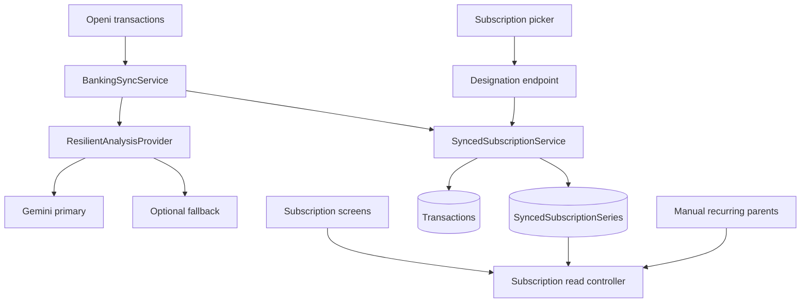

# Synced Subscriptions Design

**Spec**: `.specs/features/synced-subscriptions/spec.md`
**Status**: Approved

---

## Architecture Overview

Approach A adds a dedicated synced-series aggregate and leaves manual recurring subscriptions unchanged. A synced series owns classification state and forecast metadata. Transactions remain financial records imported exclusively from Openi. A nullable relation groups their payment history without using recurrence fields or `parentTransactionId`.

The import pipeline depends on a provider-neutral analysis contract. `ResilientAnalysisProvider` chunks requests, calls Gemini first, and optionally retries a failed chunk with one fallback. Provider code performs analysis only. All series validation, ownership checks, and persistence remain in backend services.



### Why not the alternatives

- Reusing `parentTransactionId` would mix occurrence grouping with recurrence semantics and inherit cascade-deletion behavior.
- Migrating manual subscriptions to a new aggregate would add a production backfill and regression surface unrelated to the synced-account defect.

---

## Code Reuse Analysis

### Existing Components to Leverage

| Component | Location | How to Use |
| --------- | -------- | ---------- |
| Subscription flags | `smart-finances-backend/prisma/schema.prisma` | Keep for manual subscriptions and picker compatibility; synchronize the flag on linked synced rows |
| Subscription recurrence math | `smart-finances-backend/src/services/subscription.service.ts` | Reuse day clamping and manual DTO formatting; add synced forecast helpers separately |
| Gemini SDK integration | `smart-finances-backend/src/services/gemini.service.ts` | Extend to enriched analysis while preserving minimal, privacy-safe inputs |
| Categorization seam | `smart-finances-backend/src/services/categorization.provider.ts` | Evolve into the provider-neutral enriched-analysis contract |
| Import dedup and batching | `smart-finances-backend/src/services/bankingSync.service.ts` | Reuse provider ID dedup, category fallback, 25-item pacing, and notification behavior |
| Subscription routes | `smart-finances-backend/src/routes/subscription.routes.ts` | Add synced designation and state mutations under the authenticated router |
| Transaction edit endpoint | `smart-finances-backend/src/controllers/transaction.controller.ts` | Bridge explicit subscription flags to series state for synced transactions |
| React Query hooks | `SmartFinances/src/hooks/useSubscription*.ts` | Extend DTOs and add synced designation/state mutations with existing invalidations |
| Candidate filtering | `SmartFinances/src/utils/subscriptionDesignation.ts` | Branch selector behavior by account integration without changing manual rules |
| Subscription screens | `SmartFinances/src/screens/Subscriptions`, `SubscriptionDetails`, `SubscriptionPayments` | Reuse navigation, lists, and payment summaries with the union read model |

### Integration Points

| System | Integration Method |
| ------ | ------------------ |
| PostgreSQL | New series table, enum, indexes, and nullable transaction FK; no historical data backfill |
| Openi | Existing provider transaction payloads and dedup keys; no new Openi calls |
| Gemini | Existing SDK and API key; enriched structured JSON response |
| Fallback LLM | Future implementation of the same single-chunk analysis interface; no SDK selected now |
| Expo app | Existing Axios API client and TanStack Query cache keys |

---

## Data Models

### Prisma

```prisma
enum SyncedSubscriptionStatus {
  ACTIVE
  DISMISSED
}

model SyncedSubscriptionSeries {
  id                       String                  @id @default(uuid())
  userId                   String                  @map("user_id")
  accountId                Int                     @map("account_id")
  merchantKey              String                  @map("merchant_key")
  direction                TransactionType
  name                     String
  forecastPeriod           RecurrencePeriod?       @map("forecast_period")
  status                   SyncedSubscriptionStatus @default(ACTIVE)
  hideFromSubscriptionList Boolean                 @default(false) @map("hide_from_subscription_list")
  createdAt                DateTime                @default(now()) @map("created_at")
  updatedAt                DateTime                @updatedAt @map("updated_at")

  user         User          @relation(fields: [userId], references: [id], onDelete: Cascade)
  account      Account       @relation(fields: [accountId], references: [id], onDelete: Cascade)
  transactions Transaction[]

  @@unique([accountId, merchantKey, direction])
  @@index([userId, status, hideFromSubscriptionList])
  @@index([accountId, status])
  @@map("synced_subscription_series")
}

model Transaction {
  // Existing fields remain unchanged.
  isSubscription             Boolean  @default(false) @map("is_subscription")
  syncedSubscriptionSeriesId String?  @map("synced_subscription_series_id")
  syncedSubscriptionSeries   SyncedSubscriptionSeries? @relation(fields: [syncedSubscriptionSeriesId], references: [id], onDelete: SetNull)

  @@index([syncedSubscriptionSeriesId, transactionDate])
}
```

`User` and `Account` gain the inverse series relations. The existing unused `Subscription` scaffold remains untouched; this feature does not infer its production state or migrate it.

### Invariants

- Series identity is `(accountId, merchantKey, direction)`. `userId` always equals the account owner.
- `direction` is only CREDIT or DEBIT in service validation, although it reuses the Prisma enum.
- `forecastPeriod` is only MONTHLY, YEARLY, or null in service validation.
- An ACTIVE series with at least one linked charge has `isSubscription=true` on those charges.
- A DISMISSED series retains its links for preference and history, but all linked charges have `isSubscription=false`.
- Hiding changes visibility only. It does not change status or matching.
- Deleting a charge clears its FK through `SetNull`; it does not delete the series.
- Deleting an account or user deletes the series through the owning relation.
- No migration modifies existing manual recurring rows or generated children.

### Migration

Create a local Prisma migration with the new enum, table, FK, and indexes. The repository ignores `prisma/migrations/`; the SQL must still be generated and reviewed locally. Production migration execution is outside the approved local implementation blast radius.

---

## Components

### Provider-neutral analysis contract

- **Location**: `smart-finances-backend/src/services/categorization.provider.ts`
- **Purpose**: Define enriched analysis without exposing provider SDKs to import or subscription code.

```typescript
type ForecastPeriod = "MONTHLY" | "YEARLY";

interface SeriesCandidate {
  id: string;
  name: string;
  merchantKey: string;
  status: "ACTIVE" | "DISMISSED";
}

interface AnalysisContext {
  seriesCandidates?: SeriesCandidate[];
}

interface TransactionAnalysis {
  id: string;
  category_id: string;
  is_subscription: boolean;
  merchant_key: string | null;
  matched_series_id: string | null;
  recurrence_period: ForecastPeriod | null;
}

interface AnalysisProvider {
  readonly name: string;
  analyze(
    transactions: MinimalTransaction[],
    categories: CategoryOption[],
    context?: AnalysisContext,
  ): Promise<TransactionAnalysis[]>;
}
```

`analyze` handles one chunk of at most 25 transactions and throws on request failure or an unusable response. Missing optional classification fields produce an ordinary unclassified result. A `matched_series_id` is only a model suggestion until backend validation.

### ResilientAnalysisProvider

- **Location**: `smart-finances-backend/src/services/resilientAnalysis.provider.ts`
- **Purpose**: Chunk, pace, time out, and fail over analysis without provider-specific branches in callers.

```typescript
class ResilientAnalysisProvider {
  constructor(primary: AnalysisProvider, fallback?: AnalysisProvider, options?: {
    batchSize?: number;       // default 25
    timeoutMs?: number;       // default 20_000
    spacingMs?: number;       // default 1_000
  });

  analyzeBatch(
    transactions: MinimalTransaction[],
    categories: CategoryOption[],
    context?: AnalysisContext,
  ): Promise<TransactionAnalysis[]>;
}
```

For each chunk:

1. Call the primary once with the configured timeout.
2. On failure, call the fallback once when configured.
3. On total failure, return the existing default-category assignment for every row with `is_subscription=false`.
4. Preserve input order and one result per input ID.
5. Wait `spacingMs` between chunks, not between individual transactions.
6. Log provider name, chunk index, and error class only. Do not log raw prompts, responses, or provider payloads.

The default composition exports Gemini with no fallback. A future provider is added only at this composition point.

### GeminiService

- **Location**: `smart-finances-backend/src/services/gemini.service.ts`
- **Purpose**: Implement `AnalysisProvider` with one structured response per input transaction.
- **Response fields**: `id`, `category_id`, `is_subscription`, `merchant_key`, `matched_series_id`, `recurrence_period`.
- **Prompt inputs**: Existing minimal transaction fields, category IDs/names, and same-account series candidates. Never include payer/receiver documents, balances, or complete raw Openi objects.
- **Parsing**: Invalid JSON or a non-array response throws so the resilient wrapper can fail over. Invalid optional subscription values sanitize to false/null. Missing category IDs use the existing default category.
- **Compatibility**: Existing category-only behavior is expressed as enriched results with `is_subscription=false`; callers do not need a second categorization request.

### SyncedSubscriptionService

- **Location**: `smart-finances-backend/src/services/syncedSubscription.service.ts`
- **Purpose**: Own normalization, series resolution, designation, dismissal, visibility, and forecast calculations.

Key operations:

```typescript
normalizeMerchantKey(value: string): string;
designateTransaction(transactionId: number, userId: string, db?: Prisma.TransactionClient): Promise<Series>;
dismissSeries(seriesId: string, userId: string, db?: Prisma.TransactionClient): Promise<void>;
setSeriesHidden(seriesId: string, userId: string, hidden: boolean): Promise<void>;
resolveImportedSeries(input: ResolvedAnalysis, db?: Prisma.TransactionClient): Promise<Series | null>;
getNextSyncedForecast(latestPayment: Date, period: ForecastPeriod | null, now?: Date): Date | null;
getSyncedForecastInMonth(latestPayment: Date, period: ForecastPeriod | null, monthStart: Date): Date | null;
```

Designation rules:

- Load the transaction with its account and existing series. Enforce user ownership, synced account, and CREDIT/DEBIT type.
- If already linked, reactivate that series and synchronize all linked flags.
- Otherwise resolve by normalized transaction description and the unique identity tuple.
- Reactivate a matching DISMISSED series only because this operation is explicit.
- Create an ACTIVE series with no forecast when none exists. Manual designation does not call an LLM.
- Link the selected charge without touching recurrence fields, account balance, or child transactions.

Imported-series rules:

- Ignore `matched_series_id` unless it belongs to the candidates loaded for the same account and direction.
- A matching DISMISSED candidate suppresses linking.
- Otherwise resolve the normalized `merchant_key` through the unique tuple.
- On concurrent creation, handle Prisma P2002 by refetching the unique row.
- A positive classification requires either a valid matched candidate or a nonempty canonical merchant key.
- Investment movements bypass subscription analysis entirely.

### Subscription read model

- **Location**: `smart-finances-backend/src/services/subscription.service.ts`, `src/controllers/subscription.controller.ts`
- **Purpose**: Return manual recurring parents and synced series through one DTO.

```typescript
type SubscriptionSource = "MANUAL" | "SYNCED";

interface SubscriptionDTO {
  id: string;                       // manual parent id as string, or synced series UUID
  source: SubscriptionSource;
  transaction_id: number | null;     // manual parent only
  description: string;
  amount: number;
  currency: CurrencyDTO;
  category: CategoryDTO;
  recurrence_period: "MONTHLY" | "YEARLY" | null;
  recurrence_interval: number | null; // manual value; synced forecast uses 1 when set
  day: number;
  next_payment_at: string | null;
  last_payment_at: string;
  is_subscription: boolean;
  hide_from_subscription_list: boolean;
}
```

Manual rows keep the existing computation. Synced rows use the latest linked charge for representative values and last payment. List and detail queries fetch only the latest charge. Payment queries fetch only charges inside the requested month.

The visible list includes:

- Existing visible manual recurring parents.
- ACTIVE, visible synced series with at least one linked charge.

Results are sorted by description after combining both sources. Details accept either a positive numeric manual ID or a UUID. Hidden and dismissed details remain reachable by ID for state changes and in-session undo.

### Synced forecast and payments

- `next_payment_at` starts at latest actual payment + one month/year, clamps the day to the target month, and advances until it is on or after the start of today.
- A forecast for a requested month exists only after the latest actual payment's month and when that month is the next expected month according to interval 1.
- Actual linked charges in the requested month are returned individually as `is_paid=true`, `is_forecast=false`, with actual dates and amounts.
- A pending forecast (`is_paid=false`, `is_forecast=true`) is added only when the month has no actual charge for that series.
- Null periodicity produces no forecast rows and `next_payment_at=null`.
- Existing `getUpcomingPaymentsSummary` automatically excludes null forecasts and needs no formula change.

### API endpoints

| Method | Path | Purpose |
| ------ | ---- | ------- |
| POST | `/api/v1/subscription/synced/designate` | Designate an owned synced transaction; body `{ transaction_id }` |
| PATCH | `/api/v1/subscription/synced/:id` | Dismiss with `{ is_subscription: false }` or set visibility with `{ hide_from_subscription_list }` |
| GET | `/api/v1/subscription` | Combined manual and synced visible list |
| GET | `/api/v1/subscription/payments?month=YYYY-MM` | Combined actual and forecast payments |
| GET | `/api/v1/subscription/:id` | Numeric manual ID or synced UUID detail |

All routes use `authenticate`. Designation returns 404 for missing/not-owned transactions and 422 for transfers or unsynced accounts. Synced state mutations return 404 for missing/not-owned series. Request schemas reject unknown fields and require at least one state field.

`PATCH /transaction/edit` remains the manual mutation. For a synced transaction, an explicit `is_subscription` change invokes the same series service in the surrounding transaction. It never derives or changes recurrence from the subscription flag.

### Frontend data and mutations

- `SubscriptionProps.id` and `SubscriptionPaymentProps.subscription_id` become strings.
- Add `source`, nullable `transaction_id`, and `is_forecast` where applicable.
- `AccountProps` exposes the already returned `banking_integration` field used to identify synced rows.
- Add `useDesignateSyncedSubscriptionMutation` and `useUpdateSyncedSubscriptionMutation`.
- Both invalidate subscriptions, the affected detail, payments, and transactions. Designation does not invalidate accounts because balances do not change.
- Manual mutations retain their current endpoint and invalidations.

### Frontend designation flow

`handleSelectTransaction` branches on `transaction.account.banking_integration`:

- Synced: call designation mutation. Dismiss modals and refetch only on success. Keep the picker open and show the specified alert on error. Disable candidate presses while pending.
- Manual: preserve the existing RegisterTransaction path with advanced selectors expanded.

### RegisterTransaction behavior

The selector helpers receive an `isSyncedAccount` input:

- Synced subscription ON/OFF changes only series designation intent. It does not enable recurrence, normalize period, or open RecurrenceSelect.
- Synced recurrence OFF or DAILY/WEEKLY does not clear subscription intent.
- Hydration derives recurrence only from `is_recurring` for synced rows. Manual rows preserve legacy hydration.
- Saving still sends the explicit subscription flag, allowing the backend bridge to update the whole series.

### Subscription details and lists

- Synced details hide the legacy edit button and modal because those controls mutate an anchor transaction.
- Synced dismissal and visibility use the synced mutation. Manual actions remain unchanged.
- With no forecast periodicity, list and details show `Sem previsão da próxima cobrança`.
- With a forecast, existing recurrence labels and upcoming-payment totals are reused.
- Actual payment rows use existing paid styling. Forecast rows use existing pending styling.
- The empty-list/help copy mentions both manual recurring subscriptions and imported subscription detection.

---

## State Transitions

| Current state | Trigger | Next state | Matching behavior |
| ------------- | ------- | ---------- | ----------------- |
| No series | Manual synced designation | ACTIVE | Future matching enabled |
| No series | Positive automatic analysis | ACTIVE | Future matching enabled |
| ACTIVE | New matching import | ACTIVE | Charge linked |
| ACTIVE | Dismiss | DISMISSED | All charges undesignated; future automatic linking blocked |
| DISMISSED | New matching import | DISMISSED | Charge remains unlinked |
| DISMISSED | Explicit designation | ACTIVE | Series and linked history restored |
| ACTIVE/DISMISSED | Hide/unhide | Same status | Visibility only; matching unchanged |
| ACTIVE | Last charge deleted | ACTIVE, empty | Not listed; future matching preference retained |

---

## Error Handling Strategy

| Error Scenario | Handling | User Impact |
| -------------- | -------- | ----------- |
| Primary analysis fails | Retry the chunk once with configured fallback | None when fallback succeeds |
| All analysis providers fail | Default category, no automatic subscription, sanitized log | Transactions import normally |
| Invalid matched series ID | Ignore the model suggestion and resolve by validated merchant key | No cross-series or cross-user link |
| Designation request fails | Keep picker open, re-enable rows, show specified alert | No false success or modal dismissal |
| Repeated designation | Return the existing/reactivated series idempotently | One series and one membership |
| Concurrent series creation | Unique tuple plus P2002 refetch | One series |
| Unknown periodicity | Store null and suppress forecast rows | Friendly no-forecast message |
| Transaction deleted | Set relation null and recompute latest representative on next read | Remaining history and preference retained |
| Production migration needed | Supply reviewed migration only | No remote action without explicit approval |

---

## Risks & Concerns

| Concern | Location | Impact | Mitigation |
| ------- | -------- | ------ | ---------- |
| Large transaction editor couples recurrence and subscription state | `SmartFinances/src/screens/RegisterTransaction/index.tsx:382-425,1563-1594,1983-2003` | Synced edits can recreate the duplication defect through another entry point | Centralize account-aware selector transitions and test synced/manual branches |
| Current list query hardcodes recurring parents | `smart-finances-backend/src/controllers/subscription.controller.ts:32-39` | Non-recurring imported charges cannot appear | Replace with a combined read model while preserving manual predicates |
| Gemini currently swallows chunk errors and logs raw invalid output | `smart-finances-backend/src/services/gemini.service.ts:109-126,134-163` | Outer fallback cannot detect failure; sensitive text may reach logs | Move failure handling to the resilient wrapper and remove raw response logging |
| Existing test fakes only model categorization | `smart-finances-backend/src/__tests__/bankingSync.service.test.ts:33-44` | Tests could miss enriched-analysis and series behavior | Extend fakes to the new contract and assert persisted relations and flags |
| No current subscription controller route tests | `smart-finances-backend/src/__tests__` | Combined reads, ownership, and failure paths could regress unnoticed | Add controller tests for list, detail, payments, designation, dismissal, and errors |
| LLM merchant output is untrusted | `smart-finances-backend/src/services/gemini.service.ts` | Arbitrary IDs or keys could misgroup history | Validate matched IDs against loaded candidates, normalize keys, and enforce unique account-scoped identity |
| Import batch can create many series rows | `smart-finances-backend/src/services/bankingSync.service.ts:454-502` | N+1 lookups would slow sync | Load candidates once per account batch and update the in-memory map after each resolution |
| Existing Prisma migrations are ignored and absent locally | `smart-finances-backend/.gitignore:27-29` | Deployment can miss required SQL | Generate and review the migration locally; report that remote application requires separate approval |
| Manual DTO IDs are numeric today | `SmartFinances/src/interfaces/subscriptions.ts:6-20` | UUID series IDs would break routing and mutations | Normalize public IDs to strings and keep nullable `transaction_id` for manual edits |
| Existing user work is present on the frontend branch | `SmartFinances/src/screens/BankingIntegrations/index.tsx`, `PremiumBenefits/index.tsx` | Accidental overwrite would lose unrelated work | Do not edit or revert these files; commit only feature-scoped paths |

---

## Tech Decisions

| Decision | Choice | Rationale |
| -------- | ------ | --------- |
| Synced aggregate | Dedicated `SyncedSubscriptionSeries` | Separates classification from recurrence and preserves deletion-safe history |
| Manual compatibility | Keep existing recurring-parent model and endpoints | Avoids unrelated migration and regression |
| Public IDs | String manual IDs and synced UUIDs | One route and frontend DTO can serve both sources |
| Merchant matching | Candidate ID suggestion plus validated canonical key | Handles description variants without trusting arbitrary model output |
| Manual designation | Deterministic normalization, no LLM request | Marking remains available during provider outages |
| Analysis failover | Per chunk, one optional fallback attempt | Limits cost and prevents duplicate successful analysis |
| Synced forecasts | Stored periodicity, computed dates | No recurrence engine or future transaction writes |
| Series deletion | Preference survives charge deletion; account deletion cascades | Retains dismissal behavior without retaining data after its owner disappears |
| Fallback model selection | Deferred | OpenCode Go Plus entitlement, production terms, limits, quality, and cost need a separate evaluation |

---

## Test Strategy

- Provider contract: success, primary failure with fallback, no fallback call on success, total failure, malformed responses, timeout, batch order, pacing, and sanitized logs.
- Series service: ownership/eligibility, idempotency, concurrent P2002, matching, dismissed suppression, explicit reactivation, hide behavior, deletion-derived empty state, and recurrence preservation.
- Forecasts: monthly/yearly, leap years, short months, old latest payments, null periodicity, actual-payment dedup, and multiple actual charges.
- Controllers: every new route's happy path, validation, ownership, and provider/persistence errors; combined manual/synced list and month payments.
- Import: enriched persistence, existing active/dismissed matching, invalid matched IDs, investments excluded, provider dedup, and total LLM failure.
- Frontend utilities/screens: synced versus manual picker branches, mutation failure state, account-aware RegisterTransaction selectors, no-forecast copy, details actions, and actual/forecast payment display.
- Gates: backend `yarn build` and `yarn test:unit`; frontend targeted Jest suites, full Jest baseline comparison, and ESLint on touched files.
