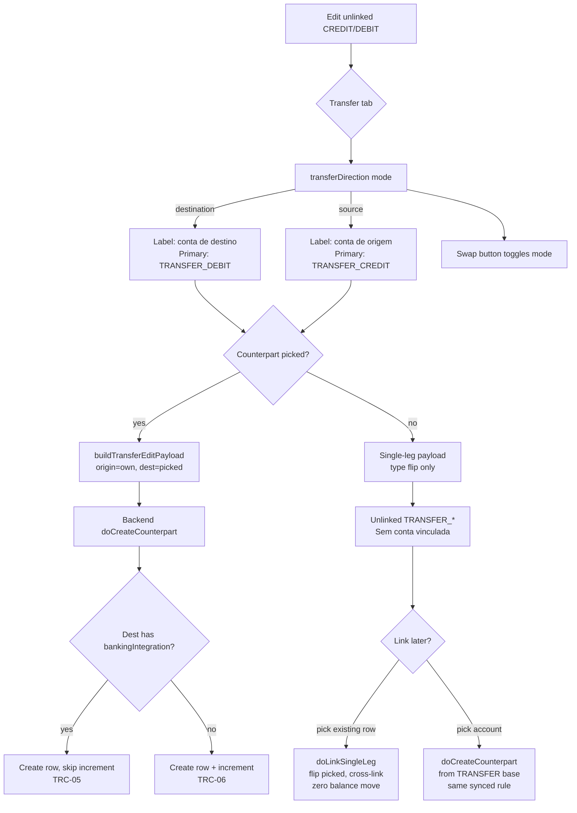

# Transfer Correction Design

**Spec**: `.specs/features/transfer-correction/spec.md`
**Status**: Draft

---

## Architecture Overview

Approach A (confirmed): the transfer contract is untouched. Direction lives entirely in the editor as a `transferDirection` mode (`'destination'` | `'source'`) that drives the counterpart label and the pending primary leg type. The backend reuses the existing `doCreateCounterpart` path plus one guard: skip the destination `balance.increment` when that account is bank-synced. Single-leg reuses the `TRANSFER_*` enum with a null link — a path the update controller already falls through to (type flips, no counterpart created, primary balance net zero).



---

## Code Reuse Analysis

### Existing Components to Leverage

| Component | Location | How to Use |
| --------- | -------- | ---------- |
| `buildTransferEditPayload` | `SmartFinances/src/utils/transactionPayload.ts` | Reuse unchanged for the with-counterpart save; direction only changes `primaryType` (`TRANSFER_CREDIT` in source mode) |
| `resolveSingleLegRate`, `convertToAccountCurrency` | `SmartFinances/src/utils/transactionPayload.ts` | Reuse for the single-leg own-account conversion (same helpers, one leg) |
| `canSelectTransferTab` | `SmartFinances/src/utils/transactionPayload.ts` | Reuse unchanged: already allows unlinked plain → transfer and unlinked `TRANSFER_*` to stay on the tab |
| `shouldShowTransferLink`, `resolveTransferLinkTitle` | `SmartFinances/src/utils/transferLink.ts` | Reuse unchanged: link already hides when `relatedTransactionId` is null |
| `AccountDestinationSelect` | `SmartFinances/src/screens/AccountDestinationSelect/` | Reuse unchanged (no picker change; empty selection = single-leg) |
| Transfer-exclusion in reports | `SmartFinances/src/utils/buildBudgetHistory.ts`, `buildNetWorthEvolution.ts` | Reuse unchanged if exclusion is type-based (verify in Tasks that null-link legs are excluded) |
| `doCreateCounterpart` branch | `smart-finances-backend/src/controllers/transaction.controller.ts:868-943` | Add the synced-account guard around the single `account.update` increment; widen the `isPlain` gate to also accept an unlinked `TRANSFER_*` base (TRC-16) |
| `doLinkExisting` block + `linkPair` | `transaction.controller.ts:653-664,855-867` + `transferMatcher.service.ts:96-125` | Reference implementation for the new `doLinkSingleLeg` branch: same validations, same zero-balance-move writes |
| `updateTransactionSchema` | `smart-finances-backend/src/schemas/transaction.schema.ts` | No change: `type`, `updateRelated`, `related_transaction_account_id` (nullable) already admit both payloads |
| `GET /transaction` list DTO | `smart-finances-backend/src/controllers/transaction.controller.ts:64-150` | Additive `related_transaction_id` field so the link picker filters to unlinked rows (TRC-19) |
| `TransactionSelect` + `selectSubscriptionCandidates` | `SmartFinances/src/screens/TransactionSelect/index.tsx`, `src/utils/subscriptionDesignation.ts` | Add an optional filter prop (default = today's candidates, SD behavior unchanged); counterpart mode passes an opposite-type/unlinked/other-account predicate |

### Integration Points

| System | Integration Method |
| ------ | ------------------ |
| `GET /transaction/:id` detail | Already returns `related_transaction.account`; no new fetch for direction defaults |
| `PATCH /transaction` update | Same route; direction travels as the existing `type` field (`TRANSFER_DEBIT` vs `TRANSFER_CREDIT`) — no new param |
| Synced-account detection | `account.bankingIntegrationId != null` on the already-fetched `destinationAccount` row |

---

## Components

### Transfer direction mode + swap control (frontend)

- **Purpose**: Let the converter pick source vs destination and derive the correct pending primary type.
- **Location**: `SmartFinances/src/screens/RegisterTransaction/index.tsx` (edit-conversion path only).
- **Interfaces**:
  - `transferDirection: 'destination' | 'source'` — initialized from stored type on tab select (`DEBIT` → destination, `CREDIT` → source), toggled by the swap button; linked-transfer edit never sets it.
  - `getSecondAccountButtonText()` — returns "Selecione a conta de destino" / "Selecione a conta de origem" / picked name / "Sem conta vinculada" (when the edited row is already an unlinked transfer).
  - Save branching: counterpart picked → existing `buildTransferEditPayload` with `primaryType` from mode; empty → new single-leg payload.
- **Dependencies**: `transactionData.type`, `accountDestinationSelected`.
- **Reuses**: Existing selectors, `SelectButton`, icon set (`ArrowsLeftRightIcon` family).

### Conversion-direction + single-leg payload helpers (frontend)

- **Purpose**: Pure, unit-tested derivation of mode default, primary type, and the single-leg update body.
- **Location**: `SmartFinances/src/utils/transactionPayload.ts` (additive only).
- **Interfaces**:
  - `resolveConversionDirection(storedType): 'destination' | 'source'` — `CREDIT` → source, else destination.
  - `resolveConversionPrimaryType(mode): 'TRANSFER_CREDIT' | 'TRANSFER_DEBIT'`.
  - `buildSingleLegTransferPayload(input): UpdateBody` — `{ transaction_id, type, amount, amount_in_account_currency, exchange_rate, currency_id, account_id, updateRelated: true }` with no counterpart fields; own-leg conversion via existing rate helpers.
- **Dependencies**: None beyond existing quote/rate helpers.
- **Reuses**: `convertToAccountCurrency`, `resolveSingleLegRate`, `normalizeTags`, recurrence fields.

### Synced-counterpart balance guard (backend)

- **Purpose**: Never corrupt a provider-owned balance when manufacturing the missing leg.
- **Location**: `smart-finances-backend/src/controllers/transaction.controller.ts`, `doCreateCounterpart` block (~L933-943).
- **Interfaces**: No contract change. After fetching `destinationAccount`, wrap the trailing `account.update increment` in `if (destinationAccount.bankingIntegrationId == null)`. Add a same-account 400 next to the existing conversion guards (`destinationAccountId === parseInt(transaction_id)`'s account → reject). Widen the `isPlain` gate to also accept an unlinked `TRANSFER_*` base so single-legs can grow a counterpart later (TRC-16).
- **Dependencies**: `destinationAccount` row (already fetched, already carries `bankingIntegrationId`).
- **Reuses**: Existing `computeBalanceDelta`, existing error style (`AppError`).

### Link single-leg to an existing transaction (backend)

- **Purpose**: Attach a late-arriving (or user-found) counterpart with zero balance risk.
- **Location**: `smart-finances-backend/src/controllers/transaction.controller.ts`, widened conversion gate + same-account guard on the existing `doLinkExisting` path (no new branch — implemented simplification: `doLinkExisting` already validates ownership/link/type and writes zero balance moves, so the widened `isUnlinkedTransferBase` gate reuses it for single-leg bases).
- **Interfaces**: No contract change — reuses `counterpartTransactionId`. Conditions: `updateRelated`, existing row unlinked `TRANSFER_*` (via the widened gate), `newType` is the existing side, counterpart unlinked plain of the complementary type (`TRANSFER_CREDIT`↔`DEBIT`, `TRANSFER_DEBIT`↔`CREDIT`), different account (new 400 guard), same user. Writes flip the picked row to its `TRANSFER_*` side and cross-link both ids. No `account.update` at all (same-sign flips, plus synced accounts are provider-owned).
- **Dependencies**: Counterpart row fetch (same pattern as the plain-leg link path).
- **Reuses**: `oppositeTransferType` mapping, `doLinkExisting` validation order (ownership → linked → type → same-account).

### Counterpart chooser + link picker (frontend)

- **Purpose**: One tap target for both attach paths on an unlinked leg.
- **Location**: `SmartFinances/src/screens/RegisterTransaction/index.tsx` + `TransactionSelect` (filter prop) + `TransactionProps` (`related_transaction_id?`).
- **Interfaces**:
  - Counterpart `SelectButton onPress` while unlinked opens the existing alert-options pattern: "Selecionar conta" → account sheet (create path) | "Vincular transação existente" → transaction sheet (link path) | "Remover" when a selection exists.
  - Save branching gains a third arm: existing transaction picked → `{ type: existingSide, updateRelated: true, counterpartTransactionId }`.
  - List DTO gains `related_transaction_id`; picker predicate = unlinked + opposite plain type + other account.
- **Dependencies**: `useTransactionsQuery` (already used by the picker screen).
- **Reuses**: `ModalViewSelection` bottom sheets, `TransactionSelect` list chrome, alert-options pattern from `handleClickSelectImage`.

---

## Data Models (if applicable)

No model changes. Both flows reuse the existing `Transaction` row:

```typescript
// Single-leg: a TRANSFER_* row with no link. No migration.
interface SingleLegTransfer {
  type: 'TRANSFER_CREDIT' | 'TRANSFER_DEBIT' // from CREDIT / DEBIT respectively
  relatedTransactionId: null
  accountId: number // unchanged primary account
}
```

**Relationships**: Unlinked legs are invisible to `syncTransferPairOnUpdate` / `unlinkTransferPair` (both key off `relatedTransactionId`), hidden from the transfer-link row by the existing null check, and deleted as ordinary rows.

---

## Error Handling Strategy

| Error Scenario | Handling | User Impact |
| -------------- | -------- | ----------- |
| Save conversion with counterpart == current account | Frontend blocks with validation alert; backend 400 as backstop | "Não é possível transferir para a mesma conta" (wording at implementer discretion) |
| Convert an already-linked plain row | Existing "Não é possível converter..." alert (unchanged) | Same as today |
| Move primary account during conversion | Existing 400 "without moving accounts" (unchanged) | Same as today |
| Counterpart account deleted / not found | Existing 404, nothing written (atomic block unchanged) | Same as today |
| Synced counterpart (normal case, not error) | Row created, balance increment skipped, success response unchanged | Balance stays provider-correct; history shows the leg |

---

## Risks & Concerns

| Concern | Location (file:line) | Impact | Mitigation |
| ------- | -------------------- | ------ | ---------- |
| Report exclusion might key off link presence instead of type | `SmartFinances/src/utils/buildBudgetHistory.ts`, `buildNetWorthEvolution.ts` | Unlinked transfers still skew totals (TRC-12 fails) | Tasks include a verify-first step: read the exclusion predicate; if link-based, extend to type-based in the same task |
| `TRANSFER_*` consumers assuming `related_transaction` exists | `RegisterTransaction/index.tsx:1871` (optional-chained, safe), list items | Crash on null dereference in an untested path | Tasks include a grep-and-harden step for non-optional `related_transaction` / `relatedTransaction` access in transfer render paths |
| Direction naming confusion (`destinationAccount` param holding the source side) | `SmartFinances/src/utils/transactionPayload.ts:351` | Future readers miswire origin/dest args | Document on the call site that origin is always the own account and leg types carry direction; no arg swap by design |
| Single-leg rows can never be linked later (backend `isPlain` guard) | `smart-finances-backend/src/controllers/transaction.controller.ts:678` | IMPLEMENTED in this scope: gate widened to `isUnlinkedTransferBase` (plain + unlinked TRANSFER bases share `doLinkExisting`/`doCreateCounterpart`; no new branch) + same-account 400 on both arms; TRC-14..19 tests |
| Link picker needs link state the list DTO lacks | `transaction.controller.ts:83-143`, `TransactionProps` | Linked rows offered as candidates, backend 409s on tap | Additive `related_transaction_id` in list DTO + picker predicate; default filter prop keeps SD callers unchanged |
| Primary-leg reverse+apply assumed net zero | `transaction.controller.ts:786-796` | If signs ever diverge, conversion moves synced balances | Net-zero holds because old/new deltas share the same sign by construction; a task asserts this with a dedicated test |

---

## Tech Decisions (only non-obvious ones)

| Decision | Choice | Rationale |
| -------- | ------ | --------- |
| Direction travels as leg `type`, not a new field | Source mode sends `TRANSFER_CREDIT`, destination sends `TRANSFER_DEBIT` | Zero contract/schema change; backend branches already key off `newTypeIsTransfer` + counterpart fields |
| Origin arg is always the own account | No arg swap in source mode; leg types encode direction | `syncTransferPairOnUpdate` derives the counterpart type as the opposite — swapping args would put legs in the wrong accounts |
| Synced check is server-side on `bankingIntegrationId` | Client never sends an `affectBalance` flag | Balance is a server-owned invariant; clients must not decide it (also covers API/3rd-party callers) |
| Single-leg = `TRANSFER_*` + null link, not a new enum | Reuses exclusion, icons, link-visibility, tab mapping | New enum would need migration + filter updates everywhere for identical user outcome |
| Link-existing mirrors `linkPair` exactly (no balance writes) | Same-sign type flips need no delta correction on either side | Keeps the strict auto-matcher untouched; manual linking carries zero auto-mutation risk |
| List DTO gains `related_transaction_id` (additive) | Picker filters client-side; backend still 409s linked picks as backstop | Backend stays the authority; the DTO addition cannot break existing consumers |
| Same-account transfer rejected both ends | Frontend alert + backend 400 | Frontend alone is bypassable; backend alone gives a poor message |

> **Project-level decision:** the synced-balance rule is recorded as AD-006 in `.specs/STATE.md` (counterpart creation during plain→transfer conversion never adjusts a bank-synced account's balance; the provider sync owns it).

---

## Tips

- **Load context first** - If context.md exists, decisions there are locked
- **Research when uncertain** - 5 minutes of research prevents hours of rework
- **Reuse is king** - Every component should reference existing patterns
- **Interfaces first** - Define contracts before implementation
- **Keep it visual** - Diagrams save 1000 words
- **Small components** - If component does 3+ things, split it
- **Flag concerns inline** - Risks found during research go in Risks & Concerns with a mitigation
- **Confirm before Tasks** - User approves design before breaking into tasks
