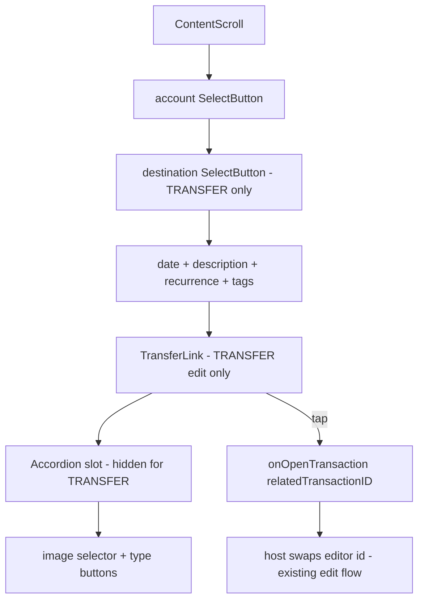

# Transfer Link Design

**Spec**: `.specs/features/transfer-link/spec.md`
**Status**: Approved (Option A, navigate on tap, hidden on create)

---

## Architecture Overview

Single insertion point in `src/screens/RegisterTransaction/index.tsx`: a `TransferLink` block rendered inside `ContentScroll`, directly above the `Accordion` JSX block (`:1756`), gated on `!isBulkEdit && transactionType === 'TRANSFER' && relatedTransactionID`. No backend change. Counterpart identity comes from the already-fetched `transactionData.related_transaction.account` (D-08). Tap-to-open is delivered through a new optional `onOpenTransaction?: (id: string) => void` prop; hosts that own the editor's id state (e.g. `TransactionsByCategory:145-153` sets `transactionId` then presents) pass `setTransactionId`-style callbacks. Hosts that don't pass it get a display-only link.



---

## Code Reuse Analysis

### Existing Components to Leverage

| Component | Location | How to Use |
| --------- | -------- | ---------- |
| `SelectButton` | `src/components/SelectButton/index.tsx` | Option A renders it directly (title + subTitle + icon + caret) |
| `Accordion` | `src/components/Accordion/index.tsx` | Anchor only: link sits directly above its JSX block; no change to the component |
| `ButtonToggle` | `src/components/ButtonToggle/index.tsx` | Reference for icon + title + subtitle row rhythm if Option C needs it |
| `resolveTransferDestinationAccount` | `src/utils/transactionPayload.ts` | Already resolves the counterpart account for the destination selector; link reuses the same `related_transaction.account` source |
| `useTransactionDetailQuery` | `src/hooks/useTransactionDetailQuery.ts` | No change; link consumes its cached `transactionData` |

### Integration Points

| System | Integration Method |
| ------ | ------------------ |
| `GET /transaction/:id` DTO | `related_transaction_id` + `related_transaction.account` already returned; read-only use |
| Host screens (`TransactionsByCategory`, `Home`, `Account`, …) | Optional `onOpenTransaction` prop; host sets its `transactionId` state to the counterpart id (same as `handleOpenTransaction`) |

---

## Components

### `TransferLink` (new, colocated)

- **Purpose**: Show the counterpart leg of a transfer and open it on tap
- **Location**: `src/screens/RegisterTransaction/components/TransferLink/` (or inline block if Option A wins — one `SelectButton`, no new files)
- **Interfaces**:
  - `counterpartAccountName: string | null` — display identity (TLINK-05)
  - `relatedTransactionId: string` — tap target (TLINK-03)
  - `onOpenTransaction?: (id: string) => void` — absent means display-only
- **Dependencies**: `transactionData.related_transaction` (already in scope), category accent color for the icon
- **Reuses**: `SelectButton` (A), phosphor `ArrowsLeftRight`/`Swap` icon family, screen's 56px row rhythm

---

## Layout Options (all positioned immediately before the Accordion)

### Option A — `SelectButton` row (recommended)

A standard `SelectButton` row between the tags `FlatList` and the `Accordion` block:

- Icon: transfer glyph (`ArrowsLeftRight`, category accent color) — same slot as `WalletIcon`/`TagIcon` rows
- Title: counterpart account name (fallback `"Transferência vinculada"`)
- SubTitle: `"Toque para ver a outra ponta"` (or origin → destination pair)
- Trailing `CaretRightIcon` comes free — it correctly signals drill-in navigation

Pros: zero new styles or components; identical 56px rhythm, padding, and accessibility shape as the six neighboring rows; tap handling is the row's native `onPress`. Cons: visually identical to the account/tag selectors above it, so it reads as "another picker" rather than a "link" — the icon + subtitle must carry the distinction.

### Option B — Transfer bridge chip (origin → destination)

A single compact banner row: `[origin account pill] → [destination account pill]` with a centered swap/arrow glyph, tappable as one unit. Direction follows the stored legs (debit origin → credit destination); the current leg's side is marked (e.g. `"você está aqui"` dot or stronger weight).

Pros: the only option that literally visualizes the *link* — both ends plus direction in one glance; clearly distinct from selector rows. Cons: new component + styles; long account names wrap or truncate (needs `numberOfLines` + flex rules); duplicates the two account selectors sitting ~200px above; direction labeling needs a copy decision.

### Option C — Info card with explicit open action

A bordered card (`border`, `radius 10`, `padding 12 16`): label `"TRANSFERÊNCIA VINCULADA"`, counterpart account + amount in counterpart currency, date; footer action `"Abrir contrapartida"` (or the whole card tappable). Read-mostly, action explicit.

Pros: richest context (amount/date answer "which leg is this?" without navigating); explicit button avoids the ambiguous-row problem; card shape can't be mistaken for a selector. Cons: heaviest visually in an already long form; amount needs currency formatting + FX-position decisions (`amount` vs `amount_in_account_currency`); overlaps the destination selector's job; most code.

### Recommendation

**Option A.** It satisfies every AC (TLINK-01..05) with one reused component, no new styles, and no copy beyond a subtitle. If user testing shows the row blends in too well, graduate to B (visual link) — B's pill row can later replace A's row in place without moving the anchor.

---

## Data Models (if applicable)

No new models. Consumed shape (already returned by the API):

```typescript
interface TransferCounterpart {
  related_transaction_id: string | null;
  related_transaction: { account: AccountProps } | null;
}
```

**Relationships**: `related_transaction_id` is the bidirectional pair link (`debit ↔ credit`, TR-1); the link navigates it, never mutates it.

---

## Error Handling Strategy

| Error Scenario | Handling | User Impact |
| -------------- | -------- | ----------- |
| Detail query loading / no `transactionData` | Render nothing | No flicker, no placeholder row |
| Create mode (`id === ''`) | Render nothing | No dead link before a counterpart exists |
| Counterpart deleted (`related_transaction` null) | Render nothing | No dead-end row |
| `onOpenTransaction` not provided by host | Row renders display-only (no `onPress`) | Informational link, never a dead tap |
| Counterpart id equals current id (data anomaly) | Render nothing | Guards a self-navigation loop |

---

## Risks & Concerns

| Concern | Location (file:line) | Impact | Mitigation |
| ------- | -------------------- | ------ | ---------- |
| `RegisterTransaction` is a ~1950-line screen with heavy local state | `src/screens/RegisterTransaction/index.tsx:160-1949` | New block + prop can interact with the id-hydration effect (`:1352-1432`, deps on `transactionData`) | Insert a pure presentational block only; id-swap reuses the existing hydration path (same as opening any transaction for edit); verify by opening both legs on device |
| Accordion is hidden for transfers (`:1757` gates on `!== 'TRANSFER'`) | `:1756-1775` | "Before the Accordion" anchor is invisible at runtime for transfers | Anchor in code order directly above the Accordion JSX block; position holds even if the accordion is ever shown for transfers |
| No screen-render test harness (per `.specs/STATE.md` test-infra notes) | repo-wide | Link row cannot be unit-rendered in jest | Gate = tsc delta + eslint on touched files + manual QA on device (open both legs, tap through); utils (if any) get unit tests |
| Every host must opt into navigation | `TransactionsByCategory:270-278`, `Home`, `Account` | Tap does nothing on hosts not passing `onOpenTransaction` | Prop is optional with display-only fallback; wire hosts incrementally, starting with the transfer-heaviest one |

---

## Tech Decisions (only non-obvious ones)

| Decision | Choice | Rationale |
| -------- | ------ | --------- |
| Anchor in code order, not visual order | Insert directly above the `Accordion` JSX block | The accordion is hidden for transfers, so only a code-order anchor is stable and reviewable |
| Optional callback prop for navigation | `onOpenTransaction?: (id: string) => void` | Zero breakage to existing hosts; navigation reuses each host's existing id-swap flow |
| No new fetch for counterpart data | Reuse `transactionData.related_transaction` | Already fetched and cached; keeps TLINK-04 (no new request) structural, not just behavioral |

> **Project-level decisions:** none — all choices are feature-local; no `AD-NNN` entry needed.
